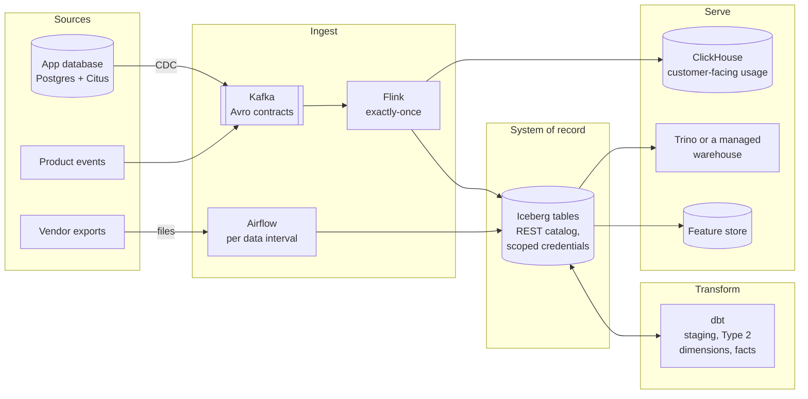

# data-platform-architecture

A reference architecture for a SaaS company's data platform: the design, the decisions behind it, and the measured results that back each decision. Every decision links to a public project where it was built and tested.

The business is the same fictional B2B subscription product used in [data-stack-lab](https://github.com/technobasant/data-stack-lab): accounts on plans, their users, monthly invoices and product usage events. Its data platform has four kinds of consumer: finance and product analysts, customers looking at their own usage inside the product, the product's own features, and models.

## The platform

Across all of it: a registry of owners, contracts, consumers and freshness objectives; freshness probes with burn-rate alerts; and GitOps releases with canary analysis.

## Principles

- **Keep history where it is cheapest to get.** Read database changes from the log, and model every attribute that facts are read against as a Type 2 dimension.
- **Load by window, write by key.** Each run loads exactly its own data interval and replaces what it wrote, so re-runs and backfills are safe in any order.
- **Exact records, reconciled aggregates.** Transactions carry each record exactly once; windowed counts are checked against the record layer, not trusted.
- **Contracts at every producer boundary.** Breaking changes wait for the consumers they break.
- **Freshness is measured where people read.** Probes, objectives and burn-rate alerts, owned by the producing team.
- **One copy of the data, replaceable engines.** Open tables behind a catalog that vends scoped credentials.
- **Nothing is recoverable until it has been recovered.** Every store has a rehearsed failover and restore with measured times.
- **Tests must be seen to fail.** Logic tests, data tests, and deliberate breaks that prove both.

## Decisions

<!-- decisions:start -->
| # | Decision | Status | Backed by |
|---|---|---|---|
| 0001 | [Three ways in: events through Kafka, database changes through CDC, vendor exports as files](decisions/0001-three-ways-in.md) | Accepted | 9 of 9 failure runs with every event layer exact; 533 of 570 account changes in a year seen by monthly snapshots |
| 0002 | [Iceberg tables on object storage, behind a catalog that vends scoped credentials](decisions/0002-open-tables-scoped-credentials.md) | Accepted | 909,968 rows recovered by snapshot rollback; 20 → 1 files merged per partition by optimize |
| 0003 | [Exactly-once by transactions upstream, idempotence at the edge, and counts reconciled per layer](decisions/0003-exactly-once.md) | Accepted | 9 of 9 failure runs with every event layer exact; 59.8% of on-time events left in the window counts after one broker kill |
| 0004 | [Contracts at every producer boundary; breaking changes wait for their consumers](decisions/0004-contracts-with-acknowledgement.md) | Accepted | 0 breaking schema changes passed as safe, in any mode; 2 of 51 changes flagged as breaking that are safe, per direction |
| 0005 | [Keep history for every attribute that facts are read against](decisions/0005-history-for-attributes-facts-read-against.md) | Accepted | 15.1% of a year's revenue on the wrong plan with a Type 1 account dimension; 5,048 of 5,048 invoices on the plan they billed, Type 2 dimension from dbt snapshots |
| 0006 | [Incremental loads take the run's data interval and replace by key; schedules name their timetable](decisions/0006-incremental-by-interval.md) | Accepted | 96.56% of a month's events lost by high-water-mark loads backfilled newest day first, every run green; 0 of 89,508 events loaded by a data-interval incremental model on Airflow 3's default @daily, in 30 successful runs |
| 0007 | [Freshness is an SLO measured from the consumer's side and alerted on burn rate](decisions/0007-freshness-slo-from-the-consumer.md) | Accepted | 6.1 s p99 from event time to queryable in ClickHouse at 1,000 events/s; 59–62 s from a frozen pipeline to a firing burn-rate alert |
| 0008 | [Serve by access pattern: a real-time OLAP store, distributed Postgres, and the lakehouse](decisions/0008-serve-by-access-pattern.md) | Accepted | 6.1 s p99 from event time to queryable in ClickHouse at 1,000 events/s; 4.2× faster join co-located than repartitioned |
| 0009 | [Every stateful store has a rehearsed failover and restore with measured times](decisions/0009-rehearsed-recovery.md) | Accepted | 8 of 8 failover scenarios passed; 10–20 s observed promotion window after SIGKILL |
| 0010 | [Three layers of tests: logic on written rows, data on real rows, and breaks to prove both](decisions/0010-three-layers-of-tests.md) | Accepted | 4 of 4 deliberate model breaks that failed the build; 5,048 of 5,048 invoices on the plan they billed, Type 2 dimension from dbt snapshots |
| 0011 | [Features for models are served point-in-time correct, from one definition online and offline](decisions/0011-point-in-time-features.md) | Accepted | 0.363 vs 0.941 future AUC-PR, naive join against point-in-time join; 99.905% of 9,500 live requests served exactly the training features |
| 0012 | [Platform services ship by canary, judged against the stable version](decisions/0012-canary-releases.md) | Accepted | 6 of 6 bad releases aborted by canary analysis; 0 of 18,003 requests failed across three good canary releases |
| 0013 | [A managed warehouse or lakehouse platform is chosen per workload, with the cost model and the team in view](decisions/0013-managed-platform-per-workload.md) | Proposed | modelled, not yet measured |
<!-- decisions:end -->

Every figure, with its method and source file, is in [EVIDENCE.md](EVIDENCE.md).

## Quality targets

| Attribute | Target | How it is measured | Evidence |
|---|---|---|---|
| Freshness, real-time path | p99 event-to-queryable under 60 s | probe events timed at the serving store | 6.1 s p99 at 1,000 events/s |
| Freshness, batch path | daily marts complete by 06:00 UTC | last successful write per dataset, on an interval | breach noticed 7.5 s late at the median |
| Completeness | every event counted at every layer | per-layer reconciliation after each run and each failure | 9 of 9 failure runs exact |
| Correctness | facts on the attribute version they happened under | unit tests on as-of joins; truth-scored labs | 5,048 of 5,048 invoices |
| Recoverability | Postgres RPO under 1 min, RTO under 5 min; tables restorable for 7 days | failover and restore drills | promotion in 10–20 s; 909,968 rows rolled back |
| Change safety | no breaking schema change ships unacknowledged | contract checks in producer CI | no breaking change passed as safe, across 51 labelled changes |

The targets, the reasoning behind each, and what is not yet measured are in [docs/quality-attributes.md](docs/quality-attributes.md).

## Reading order

| Document | What it covers |
|---|---|
| [docs/context.md](docs/context.md) | the business, its consumers, and the workload tiers every number assumes |
| [docs/architecture.md](docs/architecture.md) | the views: data flows, zones, deployment, and how each part fails |
| [docs/quality-attributes.md](docs/quality-attributes.md) | the targets above, in full |
| [docs/governance.md](docs/governance.md) | ownership, contracts, classification, personal data, access, lineage |
| [docs/operations.md](docs/operations.md) | runbooks: backfill, late input, schema change, failover, restore, rebalance |
| [docs/platform-selection.md](docs/platform-selection.md) and [cost/](cost) | Snowflake, Databricks, BigQuery or an open lakehouse, and what each would cost for this workload |
| [decisions/](decisions) | the decision records, each with its evidence |

## What this is and is not

- It is assembled from public labs on synthetic data. It is not a description of any employer's or client's platform.
- The measured results come from multi-node clusters run on one host. They show behaviour and shape (what fails, what is lost, what recovers), not capacity.
- The managed platforms are modelled from list prices, not measured. [0013](decisions/0013-managed-platform-per-workload.md) is marked Proposed for that reason.
- `python scripts/build.py --check` keeps the decision table and every decision's evidence identical to [evidence/evidence.yml](evidence/evidence.yml), and CI checks that every source link resolves.

## Licence

Apache-2.0. See [LICENSE](LICENSE).
