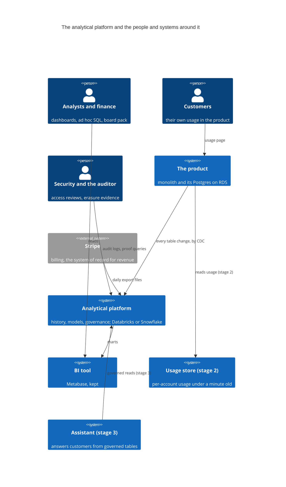
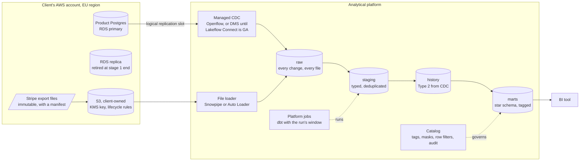
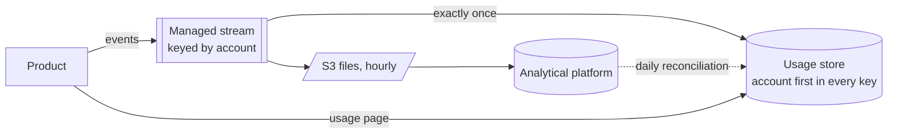

# 5. Target architecture

The destination, reached in stages. Each stage is useful on its own, has a condition for
starting and a test for being done, and leaves the next stage cheaper rather than
reworked. Platform-specific names are given for both candidates where they differ;
[0005](../decisions/0005-databricks-or-snowflake.md) chooses one.

## Context

## The stages

| Stage | When | What it delivers | Starts when | Done when |
|---|---|---|---|---|
| 0. Stopgap | weeks 0–2 | every BI query on the replica, never the primary | now | the primary serves no BI query (Q1) |
| 1. The platform | weeks 6–26 | CDC from the product, Stripe files, the star schema, the backfill of events from the S3 exports, the BI tool on the platform, governance, erasure | [0005](../decisions/0005-databricks-or-snowflake.md) accepted | Q1–Q10 (Q4 for the period the exports cover), Q13–Q15 tested; BI and finance exports read only the platform; the replica is no longer read by anything |
| 2. Customer usage | months 6–10 | events streamed to a per-account usage store; the usage page reads it | stage 1 done; the product team agrees the event stream | Q11 and Q12 tested; the usage page reads nothing from the primary |
| 3. The assistant | months 10–13 | the assistant on governed marts | stage 2 done for isolation | the [AI architecture's](https://github.com/technobasant/ai-platform-architecture) acceptance tests |

## Stage 1: the platform

- **Events** ride the same CDC path in stage 1: the product already writes them to its
  `events` table, so no product change is needed. The 90-day delete in Postgres stays; the
  platform ignores it as a business delete and keeps its own 25 months
  ([0002](../decisions/0002-cdc-from-the-product-database.md)). History from before capture
  started exists only as the nightly CSV exports in S3; wave 1 backfills them into `raw` by
  day, reconciled against each export's row count, so Q4 is met for the period they cover
  ([8. Migration](08-migration.md)).
- **Tables** are in an open format in the client's bucket
  ([0006](../decisions/0006-open-format-in-the-clients-account.md)), modelled as in
  [6. Data model](06-data-model.md).
- **The BI tool** points at the platform's SQL endpoint with its own service identity, and
  each analyst's queries run under their own role.

## Stage 2: customer usage

The product emits events to a stream instead of inserting them into Postgres, an agreed
product change. The stream feeds the usage store for the page and lands hourly files for
the platform, which takes over from CDC for events. Decided when the stage starts
([0010](../decisions/0010-customer-usage-serving.md)).

## Zones

| Zone | Contents | Written by | Read by | Kept |
|---|---|---|---|---|
| `raw` | every CDC change, and every landed file loaded into a table | ingestion only | the platform team | tables: 25 months, then expired, personal data erased by key; landed files: 30 days, by S3 lifecycle, immutable while they last ([0003](../decisions/0003-files-immutable-loads-by-key.md)) |
| `staging` | typed, deduplicated, one row per record version | dbt | the platform team | rebuilt |
| `history` | Type 2 versions of every entity a fact is reported by | dbt from CDC | dbt | indefinitely, erasure by key |
| `marts` | the star schema; every column tagged | dbt | analysts, BI, finance, the assistant (stage 3) | indefinitely, erasure by key |
| `audit` | access logs, erasure proofs, reconciliation results | the platform, jobs | security, the auditor | 7 years |

Data moves only to the right. Nothing in `marts` is written by hand, and nothing reads `raw`
except the jobs that build `staging`.

## Deployment

| Part | Where | Notes |
|---|---|---|
| Analytical platform | the vendor's service in the client's EU region | one production and one development environment, each in Terraform |
| Table storage | an S3 bucket in the client's account per environment | KMS key owned by the client; versioning off (the table format keeps versions); lifecycle rules on raw |
| CDC | Openflow (bring-your-own-cloud in the client's VPC) or AWS DMS | reaches RDS over the VPC, never the internet |
| Identity | the client's identity provider, by SCIM | people in groups, groups in roles; service principals per job |
| Observability | the platform's job and query history, plus CloudWatch for CDC | freshness and cost alerts to the data team's channel in business hours |

## How each part fails

| Part | Failure | Detected by | Recovery | Product affected? |
|---|---|---|---|---|
| CDC | the slot stalls and RDS retains WAL | WAL retained on RDS, alarmed at a threshold | restart the connector; if the slot is lost, re-snapshot the tables | only if WAL fills the disk: the alarm fires long before |
| CDC | an RDS failover or major upgrade drops the slot | connector error | recreate the slot and re-snapshot; history has a gap the size of the outage, logged | no |
| File feed | a file truncated, duplicated, late or re-sent | manifest check, the `MERGE` on key | hold the day; the producer re-sends under a new name | no |
| A model | wrong logic, well-formed rows | unit tests, deliberate breaks in CI | fix and rebuild the window | no |
| A write | an overwrite or delete of the wrong range | reconciliation, a person | restore the table to a version inside 7 days ([0015](../decisions/0015-restore-points.md)) | no |
| The bucket | a bucket, key or Terraform mistake destroys the table storage, which table versions cannot survive since they live in the same bucket | Terraform plan review; the quarterly restore drill | restore from the AWS Backup vault in a separate AWS account, then re-apply the erasure log before anything reads the restored data ([0015](../decisions/0015-restore-points.md)) | no |
| A source schema | a breaking change | the contract check in the producer's CI | change request and migration ([0013](../decisions/0013-contracts-at-the-producer.md)) | no |
| Governance | a column untagged, a filter missing | isolation tests in CI; tag coverage check | fix the tag; access logs show who read what | no |
| Cost | a query or job runs away | budget alerts, per-job attribution | kill, cap the warehouse, fix | no |
| The vendor | a regional outage | the vendor's status, freshness alerts | wait; the BI tool shows yesterday | no |

None of these touches the product, which is the point of
[0001](../decisions/0001-analytics-off-the-product-database.md); the one exception, WAL
retained by a stalled slot, is alarmed before it matters.
