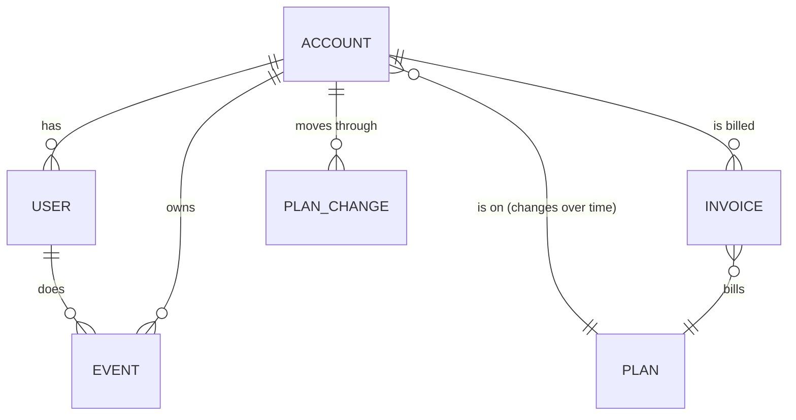

# 6. Data model

A Kimball star with Type 2 history for every attribute facts are read against
([0007](../decisions/0007-history-for-attributes-facts-read-against.md)). The same model is
built and tested, on the same shape of data, in
[data-stack-lab's dbt project](https://github.com/technobasant/data-stack-lab/tree/main/dbt),
where a Type 1 account dimension put 15.1% of a year's revenue on the wrong plan and the
Type 2 one put every invoice on the plan it billed.

## Conceptual model

The business as the people in [the brief](01-brief.md) talk about it.

Two facts drive the design. An account's plan changes, and every number about revenue or
usage has to be read against the plan *at the time*. And an invoice already knows the plan
it billed (Stripe's price), which is what revenue is reconciled against.

## The marts

| Table | Kind | Grain | History | Built from |
|---|---|---|---|---|
| `dim_account` | dimension | one row per account version | Type 2: plan, status, country, industry | CDC changes to `accounts` |
| `dim_plan` | dimension | one row per plan | Type 1 | `plans` |
| `dim_user` | dimension | one row per user | Type 1; no personal columns (e-mail domain only) | `users` |
| `dim_date` | dimension | one row per day | static | generated |
| `fct_invoices` | fact | one row per Stripe invoice | joined to the account version on `invoiced_at` | the Stripe export |
| `fct_daily_usage` | fact | one row per account, user role, event type and day | joined to the account version on the day | `events`, `users` |
| `fct_events` | fact | one row per event, 25 months | joined to the account version on `event_at` | `events` |
| `fct_plan_changes` | fact | one row per plan change: new, upgrade, downgrade, churn | from consecutive `dim_account` versions | `dim_account` |
| `revenue_by_plan` | report table | month, plan | both attributions side by side during migration | `fct_invoices` |

`fct_daily_usage` is the published one, with an output contract
([`models/contracts/usage-mart.odcs.yaml`](../models/contracts/usage-mart.odcs.yaml)) the BI
tool and, in stage 3, the assistant rely on.

## Bus matrix

Which facts share which dimensions. A dimension shared by two facts is conformed: one
table, one meaning, so a dashboard can put revenue and usage side by side.

| Fact | Date | Account (version) | Plan | User | Event type | Platform |
|---|:-:|:-:|:-:|:-:|:-:|:-:|
| `fct_invoices` | ✔ | ✔ | ✔ billed | | | |
| `fct_daily_usage` | ✔ | ✔ | ✔ that day | role | ✔ | |
| `fct_events` | ✔ | ✔ | ✔ that moment | ✔ | ✔ | ✔ |
| `fct_plan_changes` | ✔ | ✔ | ✔ from and to | | | |

## Keys and history

- **Natural keys stay.** `account_id`, `user_id`, `event_id` and Stripe's `invoice_id` are
  carried into every table that has them; `account_id` is also the row-filter key
  ([0011](../decisions/0011-tags-drive-masking-and-row-filters.md)).
- **Version keys join facts to history.** `dim_account.account_key` identifies a version;
  facts store it, chosen by an as-of join on the fact's own time.
- **The first version reaches back to signup.** An account that changed before capture
  started is first seen later than it existed; its earliest known state stands in.
- **Open versions end at 9999-12-31,** not NULL, so the as-of join is a plain range
  predicate on either platform.
- **The billed plan is a fact, not a lookup.** `fct_invoices.plan_id` comes from Stripe;
  `dim_account`'s plan at `invoiced_at` must agree with it, and the build fails when they
  differ for more than the known migration gap.

## Contracts at the sources

| Source | Contract | Delivery |
|---|---|---|
| The product's tables, by CDC | [`product-database.odcs.yaml`](../models/contracts/product-database.odcs.yaml) | every change within 15 minutes |
| Stripe's daily export | [`stripe-billing.odcs.yaml`](../models/contracts/stripe-billing.odcs.yaml) | immutable files with a manifest, by 02:00 UTC |

Each column carries a classification (public, internal, confidential, personal) that the
build turns into a catalog tag and masking policy. The contracts are in the
[Open Data Contract Standard](https://bitol-io.github.io/open-data-contract-standard/) v3.2,
linted in CI, and CI also proves the producer-side check: renaming `users.email` in a copy
of the product contract is reported by `datacontract breaking` as a breaking change.

## Physical design

Small dimensions are plain tables. The two event facts are the only large tables, and both
are read mostly by date range and by account.

| | Databricks | Snowflake |
|---|---|---|
| `fct_events`, `fct_daily_usage` | liquid clustering on (`activity_date`, `account_id`) | clustering key on (`activity_date`, `account_id`) once the table passes about 1 TB; natural insert order before that |
| Re-writing a day | `INSERT INTO … REPLACE WHERE activity_date = …` | `MERGE` or `DELETE` + `INSERT` on the window in one transaction |
| Open format ([0006](../decisions/0006-open-format-in-the-clients-account.md)) | Delta with UniForm | Snowflake-managed Iceberg tables |

Every timestamp is stored in UTC; how each platform types it on the open format is checked
in the proof of concept, because a time zone mismatch is the cheapest bug to prevent and
the most expensive to find in a revenue report.

At 36 months `fct_events` holds about 3.8 billion rows (about 0.6 TB compressed); nothing
here needs partitioning beyond clustering until well past that.
