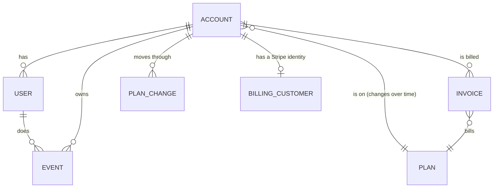

# 6. Data model

A Kimball star with Type 2 history for every attribute a fact is reported by
([0007](../decisions/0007-history-for-attributes-facts-read-against.md)), over a raw change
history rather than a Data Vault
([0016](../decisions/0016-kimball-over-a-raw-change-history.md)). Personal data lives in one
place: facts and marts carry keys, never identities
([0017](../decisions/0017-personal-data-in-one-place.md)). The same model is built and
tested, on the same shape of data, in
[data-stack-lab's dbt project](https://github.com/technobasant/data-stack-lab/tree/main/dbt),
where a Type 1 account dimension put 15.1% of a year's revenue on the wrong plan and the
Type 2 one put every invoice on the plan it billed.

## Domains and data products

Four domains. Each has one owner, one source of record, and publishes tables other teams
read rather than querying its raw layer.

| Domain | Owner | Source of record | Entities | Published data products | Consumers |
|---|---|---|---|---|---|
| Accounts and subscriptions | Product engineering | the product database, by CDC | account, plan, plan change | `dim_account`, `dim_plan`, `fct_plan_changes` | finance (plan at the time of invoicing), customer success (`fct_account_health_weekly`), BI tool, stage-3 assistant (plan context) |
| Product usage | Product engineering | the product database's `events` table, by CDC (stage 2: the event stream) | event, user (role, platform) | `fct_events`, `fct_daily_usage` | product analysts, customer success, BI tool, stage-2 usage store, stage-3 assistant |
| Billing and revenue | Finance systems | Stripe's daily export | invoice, billing customer | `fct_invoices`, `revenue_by_plan`, the `billing_customer` identity table | finance, customer success (via `fct_account_health_weekly`), BI tool |
| Customer health (derived) | Data team | derived from the other three domains | account health (weekly) | `fct_account_health_weekly`, `cs_user_contacts` | customer success, BI tool |

The first three domains each have one producing team as owner; the fourth has none upstream
of it, so the data team is both producer and owner, as [0016](../decisions/0016-kimball-over-a-raw-change-history.md)
expects of a derived product with no source of its own.

## Conceptual model

The business as the people in [the brief](01-brief.md) talk about it.

Two facts drive the design. An account's plan changes, and every number about revenue or
usage has to be read against the plan *at the time*. And an invoice already knows the plan
it billed (Stripe's price), which is what revenue is reconciled against.

`BILLING_CUSTOMER` is not a separate feed: Stripe's export delivers invoices, not customer
records ([`stripe-billing.odcs.yaml`](../models/contracts/stripe-billing.odcs.yaml) has one
schema, `invoices`), and each invoice carries the billing e-mail Stripe holds for the
account at the time. Staging de-duplicates that into one row per account, the one identity
table this source gets ([0017](../decisions/0017-personal-data-in-one-place.md)). It is a
reading of the same file, not a new source to govern.

## Logical model and glossary

| Entity | Business definition | Identifier | Source of record | History policy | Identifying attributes (classification) | Steward |
|---|---|---|---|---|---|---|
| Account | A customer organisation, on one plan at a time, that signed up to the product. | `account_id` | Product database, by CDC | Type 2 on plan, status, country, industry ([0007](../decisions/0007-history-for-attributes-facts-read-against.md)) | `account_name` (confidential), `domain` (confidential) | Product engineering |
| Plan | A priced tier an account can be on: free, team, business, enterprise. | `plan_id` | Product database, by CDC | Type 1 | `plan_name` (public) | Product engineering |
| User | A person who signs in to the product under one account. | `user_id` | Product database, by CDC | identity attributes kept in the identity table only, overwritten, never historized | `email`, `full_name` (personal) | Product engineering |
| Billing customer | The account's identity in Stripe: who an invoice is billed to. | `account_id` (one row per account) | Stripe's daily export, de-duplicated in staging | identity table, Type 1, overwritten | `billing_email` (personal) | Finance systems |
| Invoice | A Stripe invoice, billed against one plan for one period. | `invoice_id` | Stripe's daily export | append-only; immutable once billed | `amount_paid` (confidential) | Finance systems |
| Event | One recorded action by a user in the product. | `event_id` | Product database's `events` table, by CDC | append-only, 25 months | none: `user_id` and `account_id` are keys, not identities | Product engineering |
| Plan change | A transition from one account version to the next: new, upgrade, downgrade, churn. | `account_id` + the two `dim_account` versions either side | derived from consecutive `dim_account` versions | derived; rebuilt whenever `dim_account` rebuilds | none | Data team |

"Steward" here is the team a column's day-to-day correctness is escalated to, not
necessarily its accountable owner; both are defined in
[7. Security and governance](07-security-and-governance.md#operating-model).

### Glossary of metrics

Definitions are quoted verbatim from
[`ai-platform-architecture/lab/semantic.yml`](https://github.com/technobasant/ai-platform-architecture/blob/main/lab/semantic.yml)
where it defines a term, so the assistant and this platform's dashboards give the same
number for the same question. Its table is called `user_daily_activity`; this model's
equivalent, at the same grain, is `fct_daily_usage`.

| Term | Definition | In the assistant's semantic layer? |
|---|---|---|
| Active user | "COUNT(DISTINCT user_id) from user_daily_activity. Never sum a daily count of users across days." | yes, quoted |
| Events | "SUM(events)" | yes, quoted |
| Active account | An account with at least one row in `fct_daily_usage` (equivalently, at least one event in `fct_events`) for the day or period in question. | no — the semantic layer only describes usage from the customer's own side; defined here from the `usage-mart` contract's `events` and `account_id` columns |
| MRR, or revenue by plan | Revenue by plan and month: `SUM(amount_paid)` from `fct_invoices`, grouped by `plan_id` and the month of `invoiced_at`. Monthly recurring revenue is the same figure normalised to a 30-day month by each invoice's `period_start`–`period_end` length, where an invoice's period is not exactly a month. | no — the semantic layer covers usage, not billing; defined here from [`stripe-billing.odcs.yaml`](../models/contracts/stripe-billing.odcs.yaml) and the `fct_invoices` / `revenue_by_plan` tables below |
| Plan change types | From consecutive `dim_account` versions, compared on `plan_id` and `status`: **new** (the account's first version), **upgrade** (a later plan's `monthly_price_usd` is higher), **downgrade** (lower, while still active), **churn** (status moves to cancelled). | no — defined here from `fct_plan_changes` |

## Layers

| Layer | Holds | Kept | Read by | Personal data | Tests that run here |
|---|---|---|---|---|---|
| `raw` (landed files) | each delivery exactly as it arrived: Stripe's parquet files, event file drops | 30 days, then expired by S3 lifecycle ([0003](../decisions/0003-files-immutable-loads-by-key.md)) | ingestion only | yes, while a file lasts (e.g. Stripe's `billing_email`) | manifest row-count check before merge |
| `raw` (tables) | every CDC change and every loaded file row, append-only, with its log position | 25 months, then expired; personal data erased by key within 7 days of a request ([0012](../decisions/0012-erasure.md)) | the platform team | yes, every captured column | contract checks ([0013](../decisions/0013-contracts-at-the-producer.md)); row tests on arrival |
| `staging` | typed, de-duplicated, one row per record version | rebuilt on every run | dbt | yes, but confined to the identity models (`stg_users`, `stg_billing_customer`); every other staging model carries keys only | not-null, unique and relationship tests; the quality gates ([0014](../decisions/0014-quality-gates.md)) |
| `history` | Type 2 versions of the attributes a fact is reported by | indefinitely; erasure by key | dbt | no | as-of join unit tests; deliberate-break tests in CI |
| `marts` | the star schema, every column tagged | event-grain facts (`fct_events`, `fct_daily_usage`, `fct_account_health_weekly`) 25 months, matching `raw`; dimensions and `fct_invoices` indefinitely | analysts, the BI tool, finance, stage-3 assistant | no — a CI test fails the build if any mart column is tagged `personal` ([0017](../decisions/0017-personal-data-in-one-place.md)) | contract tests; reconciliation to Stripe; freshness checks |
| serving (stage-2 store) | per-account usage aggregates | TTL 25 months (design, [0010](../decisions/0010-customer-usage-serving.md)) | the usage page, the stage-3 assistant | `user_id` only, no identity | daily reconciliation to the platform (design) |

The one exception to "no personal data past staging" is the identity table per source
(`stg_users`, `stg_billing_customer`), which [0017](../decisions/0017-personal-data-in-one-place.md)
keeps precisely so that the rest of `history` and `marts` need not.

## The marts

| Table | Kind | Grain | History | Built from |
|---|---|---|---|---|
| `dim_account` | dimension | one row per account version | Type 2: plan, status, country, industry | CDC changes to `accounts` |
| `dim_plan` | dimension | one row per plan | Type 1 | `plans` |
| `dim_user` | dimension | one row per user | Type 1; no personal columns (e-mail domain only) | `users` |
| `dim_date` | dimension | one row per day | static | generated |
| `fct_invoices` | fact | one row per Stripe invoice | joined to the account version on `invoiced_at` | the Stripe export |
| `fct_daily_usage` | fact | one row per account, user role, event type and day | joined to the account version on the day | `events`, `users` |
| `fct_events` | fact | one row per event, 25 months | joined to the account version on `event_at` | `events` |
| `fct_plan_changes` | fact | one row per plan change: new, upgrade, downgrade, churn | from consecutive `dim_account` versions | `dim_account` |
| `fct_account_health_weekly` | fact | one row per account and ISO week | joined to the account version in effect that week; kept on full history (all 25 months the platform holds, not the 90 days the replica gave customer success — [8. Migration](08-migration.md#inventory)) | `fct_daily_usage` (active users, events), `dim_account` (plan), `fct_invoices` (revenue), `fct_plan_changes` (plan changes) |
| `revenue_by_plan` | report table | month, plan | both attributions side by side during migration | `fct_invoices` |
| `cs_user_contacts` | restricted view, not a mart | one row per user | not historized; reads the current identity table | `dim_user` (keys) joined to `stg_users`, the identity table |

`fct_daily_usage` is the published one, with an output contract
([`models/contracts/usage-mart.odcs.yaml`](../models/contracts/usage-mart.odcs.yaml)) the BI
tool and, in stage 3, the assistant rely on.

`fct_account_health_weekly` is customer success's table: activity, plan and revenue trends
for an account across its full history, not the 90 days the replica-backed health report
gave today ([8. Migration](08-migration.md#inventory)). `cs_user_contacts` is a restricted
view, not a published mart: it joins users' identities (e-mail, full name) to their account
for customer success alone, and nobody else's role resolves the join
([0017](../decisions/0017-personal-data-in-one-place.md)). Its mask function is the same
tag-based mask measured in [0011](../decisions/0011-tags-drive-masking-and-row-filters.md),
with one addition this repo has not yet measured: a role check (`is_account_group_member`)
so the `customer_success` role sees the value and every other reader still sees `***`. That
addition is a design, built on a measured mechanism, not itself measured.

## Bus matrix

Which facts share which dimensions. A dimension shared by two facts is conformed: one
table, one meaning, so a dashboard can put revenue and usage side by side.

| Fact | Date | Account (version) | Plan | User | Event type | Platform |
|---|:-:|:-:|:-:|:-:|:-:|:-:|
| `fct_invoices` | ✔ | ✔ | ✔ billed | | | |
| `fct_daily_usage` | ✔ | ✔ | ✔ that day | role | ✔ | |
| `fct_events` | ✔ | ✔ | ✔ that moment | ✔ | ✔ | ✔ |
| `fct_plan_changes` | ✔ | ✔ | ✔ from and to | | | |
| `fct_account_health_weekly` | ✔ week | ✔ | ✔ that week | | | |

`fct_account_health_weekly` aggregates across users, event types and platforms rather than
slicing by them, so those three columns are blank by design, not by omission.

## Keys and history

- **Natural keys stay.** `account_id`, `user_id`, `event_id` and Stripe's `invoice_id` are
  carried into every table that has them; `account_id` is also the row-filter key
  ([0011](../decisions/0011-tags-drive-masking-and-row-filters.md)).
- **Version keys join facts to history.** `dim_account.account_key` identifies a version;
  facts store it, chosen by an as-of join on the fact's own time.
- **The first version reaches back to signup.** An account that changed before capture
  started is first seen later than it existed; its earliest known state stands in.
- **Open versions end at 9999-12-31,** not NULL, so the as-of join is a plain range
  predicate on either platform.
- **The billed plan is a fact, not a lookup.** `fct_invoices.plan_id` comes from Stripe;
  `dim_account`'s plan at `invoiced_at` must agree with it, and the build fails when they
  differ for more than the known migration gap.

### SCD policy, by attribute

| Attribute | Table | Policy | Why |
|---|---|---|---|
| `plan` | `dim_account` | Type 2 | `fct_invoices` and `fct_daily_usage`/`fct_account_health_weekly` report revenue and usage by the plan in force at the time ([0007](../decisions/0007-history-for-attributes-facts-read-against.md)); a Type 1 account dimension put 15.1% of a year's revenue on the wrong plan |
| `status` | `dim_account` | Type 2 | `fct_plan_changes` and `fct_account_health_weekly` report churn and health by the status in force at the time |
| `country` | `dim_account` | Type 2 | finance and customer success segment revenue and health by the country an account was in at the time, not today's |
| `industry` | `dim_account` | Type 2 | the same, by industry |
| `role` (user) | captured at `fct_daily_usage`'s grain, not through `dim_user` | effectively Type 2, but at the fact rather than the dimension | `fct_daily_usage`'s grain already includes `user_role` per account and day ([6. Data model](06-data-model.md#the-marts)), written in from that day's CDC state directly; checked against [0007](../decisions/0007-history-for-attributes-facts-read-against.md), this is what the rule requires for an attribute a fact is reported by, it is just done without a separate Type 2 `dim_user` to join to, since nothing else needs role's history |
| `account_name` | `dim_account` | Type 1, confidential | nothing is reported by the account's name; it is read, not sliced by |
| `email`, `full_name` | the identity table only (`stg_users`, `stg_billing_customer`) | overwritten in place; erased on request; never historized | [0017](../decisions/0017-personal-data-in-one-place.md): personal columns exist only in `raw`, `staging` and the identity table, so there is no version of them to keep |

## Contracts at the sources

| Source | Contract | Delivery |
|---|---|---|
| The product's tables, by CDC | [`product-database.odcs.yaml`](../models/contracts/product-database.odcs.yaml) | every change within 15 minutes |
| Stripe's daily export | [`stripe-billing.odcs.yaml`](../models/contracts/stripe-billing.odcs.yaml) | immutable files with a manifest, by 02:00 UTC |

Each column carries a classification (public, internal, confidential, personal) that the
build turns into a catalog tag and masking policy. The contracts are in the
[Open Data Contract Standard](https://bitol-io.github.io/open-data-contract-standard/) v3.2,
linted in CI, and CI also proves the producer-side check: renaming `users.email` in a copy
of the product contract is reported by `datacontract breaking` as a breaking change.

## Physical design

Small dimensions are plain tables. The two event facts are the only large tables, and both
are read mostly by date range and by account.

| | Databricks | Snowflake |
|---|---|---|
| `fct_events`, `fct_daily_usage` | liquid clustering on (`activity_date`, `account_id`) | clustering key on (`activity_date`, `account_id`) once the table passes about 1 TB; natural insert order before that |
| Re-writing a day | `INSERT INTO … REPLACE WHERE activity_date = …` | `MERGE` or `DELETE` + `INSERT` on the window in one transaction |
| Open format ([0006](../decisions/0006-open-format-in-the-clients-account.md)) | Delta with UniForm | Snowflake-managed Iceberg tables |

Every timestamp is stored in UTC; how each platform types it on the open format is checked
in the proof of concept, because a time zone mismatch is the cheapest bug to prevent and
the most expensive to find in a revenue report.

At 36 months `fct_events` holds about 3.8 billion rows (about 0.6 TB compressed); nothing
here needs partitioning beyond clustering until well past that.

### 1. The lakehouse marts

UniForm, the format [0006](../decisions/0006-open-format-in-the-clients-account.md) chose
so a second engine can read the tables as Iceberg, refuses deletion vectors
([measured](11-proof-of-concept.md#erasure-through-time-travel)). Every row-level change —
an erasure, a CDC merge, a day rewritten — rewrites the data files it touches rather than
marking rows deleted. Where personal data sits decides how much that costs: erasing one
person (551 events) rewrote **31,849,449 rows** when the model copied e-mail and name into
every event row, and **59,999** when they lived only in a 60,000-row user table
([`results/poc-databricks-governance.json`](../results/poc-databricks-governance.json),
[0017](../decisions/0017-personal-data-in-one-place.md)). Both figures are on the same
UniForm table type this platform uses; the gap is the reason `fct_events` and
`fct_daily_usage` carry only `user_id`.

### 2. The stage-2 usage store (design, not measured)

As [0010](../decisions/0010-customer-usage-serving.md) proposes it, for whichever managed
real-time OLAP store is chosen (its evidence is ClickHouse's):

- One `MergeTree` table, `PARTITION BY` month, `ORDER BY (account_id, event_date,
  event_type)` — every read the usage page or the assistant makes is for one account
  (Q11, Q12), so the account leads the sort key.
- A materialized view rolls that table into a small aggregate table the usage page queries
  directly, so a dashboard-shaped read never scans raw events.
- A row policy per account on every customer-facing read: the caller's account is the only
  one a query can return, the same discipline as the row filters measured on the platform
  ([0011](../decisions/0011-tags-drive-masking-and-row-filters.md)).
- `TTL` at 25 months, matching the platform's own event retention.
- The table carries `user_id`, never an identity, so an erasure never has to reach it
  ([0017](../decisions/0017-personal-data-in-one-place.md)).
- Reconciled daily against the platform's own event counts, the same discipline as the
  reconciliation during migration ([8. Migration](08-migration.md#running-both)).

This is a design the decision proposes, not something run or measured in this repository;
[0010](../decisions/0010-customer-usage-serving.md)'s own evidence is from a sibling
streaming lab, not this client's data.

### 3. The product database's growth path (an option, not a decision)

If the product's primary must keep growing before stage 2 exists — more accounts and
events than a single-writer Postgres instance comfortably serves — one option for the
36-month horizon is Citus: accounts, users and events distributed by `account_id` and
colocated, so every product query touches one shard, and `plans` kept as a small reference
table replicated to every worker. This is not evaluated against the brief's constraints
here (Postgres stays untouched, [0001](../decisions/0001-analytics-off-the-product-database.md)),
and nothing in this engagement measures it on the client's data. The sibling
[distributed-db-lab](https://github.com/technobasant/distributed-db-lab) measures the
mechanism itself: an online rebalance with 0 errors while a worker joined and 7 shard groups
moved under load, and skew falling from 2.36× to 1.10× after rebalancing. That is evidence
for the growth path being workable in principle, not for this client's workload, which has
not been run against it.

### 4. The stage-3 assistant reads the stage-2 store, not a warehouse

The assistant answers from the stage-2 usage store on the same per-account path the usage
page uses, not from the analytical platform. A warehouse kept awake for it all month would
cost $2,657 at the smallest Databricks size at EU list price
([11. Proof of concept](11-proof-of-concept.md#cost-what-the-billing-table-charged)), more
than the assistant's own $1,500 cost ceiling
([ai-platform-architecture 0014](https://github.com/technobasant/ai-platform-architecture/blob/main/decisions/0014-cost-per-answer.md)).

## Modelling standards

**Naming.** `dim_` and `fct_` for marts, `stg_` for staging, `raw_` for raw tables.
`*_id` is a natural key as the source gives it; `*_key` is a version key minted here
(`dim_account.account_key`). `*_at` is a UTC timestamp; `*_date` is a calendar date with no
time zone. Money columns end `_usd` and are `decimal(18,2)`, never a float.

**Types.** `string`, not `varchar`: Databricks refuses an unbounded `VARCHAR`, and the dbt
project needed exactly that one change — `varchar` to `string` in the contract types — to
build on it after passing on DuckDB
([measured](https://github.com/technobasant/data-stack-lab/blob/main/MEASUREMENTS.md),
[0016](../decisions/0016-kimball-over-a-raw-change-history.md)). Every timestamp is UTC;
converting for display is a BI tool concern, not a model one.

**Keys and unknown members.** Every dimension has an unknown-member row (`-1`, or a
sentinel account/user) so a fact that arrives before its dimension row still joins to
something, rather than being silently dropped by an inner join.

**Late-arriving facts and dimensions.** A fact that arrives for a day already built is
handled by the window-replacing incremental pattern ([0008](../decisions/0008-incremental-by-interval.md)):
its day is rebuilt, not appended to. A dimension change that arrives out of order (an
account's plan change recorded after a later invoice has already been built) is caught by
the as-of join's unit tests and the reconciliation to Stripe ([0014](../decisions/0014-quality-gates.md)),
which would show an invoice on the wrong plan version.

**Schema evolution and deprecation.** Contracts are versioned by semver
([0013](../decisions/0013-contracts-at-the-producer.md)): an additive change (a new
nullable column) is a minor version; a breaking change (a rename, a type change, a dropped
column) is a major version, published alongside the old version for 30 days while
consumers move. Consumers of a changing table are found through the platform's lineage,
not memory, and each has to acknowledge the migration before the old version is withdrawn.

**Tests required per layer** are in [Layers](#layers) above: manifest checks on landed
files; contract and row tests on `raw`; not-null, unique and relationship tests plus the
quality gates on `staging`; as-of join unit tests and deliberate breaks on `history`;
contract tests and Stripe reconciliation on `marts`.

**Every column classified and described before it ships.** A column with no
`classification` in its contract or dbt model fails the build; this is enforced by the CI
test that every contract property has a classification in `{public, internal, confidential,
personal}`, and that no mart column is `personal`
([7. Security and governance](07-security-and-governance.md), [0017](../decisions/0017-personal-data-in-one-place.md)).

---

[← 5. Target architecture](05-target-architecture.md) · [README](../README.md) · [7. Security and governance →](07-security-and-governance.md)
