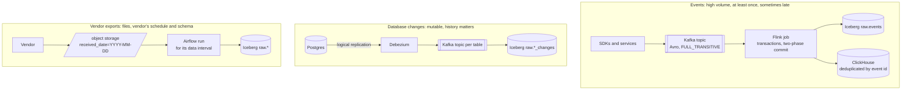

# Architecture

Four views: how data comes in, where it lives, where it runs, and how each part fails. The decisions behind each choice are in [../decisions/](../decisions).

## 1. Three paths in

| Path | What makes it correct | Decision |
|---|---|---|
| Events | Kafka and Flink transactions carry each record once; the serving store deduplicates by event id; every layer is reconciled to the topic | [0003](../decisions/0003-exactly-once.md) |
| Database changes | Every change, not every extract: history is complete, including changes undone between two extracts | [0001](../decisions/0001-three-ways-in.md) |
| Vendor exports | Partitioned by arrival day and loaded per data interval with a replacing write, so late files and re-runs are safe | [0006](../decisions/0006-incremental-by-interval.md) |

## 2. Zones

| Zone | Contents | Written by | Read by | Kept |
|---|---|---|---|---|
| `raw` | exactly what arrived, typed only as far as the contract requires | ingestion only | the platform team | 13 months, then expired |
| `staging` | typed, deduplicated, personal data normalised | dbt | the platform team | rebuilt on every run |
| `snapshots` | every version of every mutable entity | dbt snapshots or CDC merges | dbt | indefinitely |
| `marts` | Type 2 dimensions, facts at a declared grain, no personal data beyond what a use case is approved for | dbt | analysts, BI, models | indefinitely, with erasure ([governance](governance.md)) |
| serving copies | tenant-keyed aggregates in ClickHouse, features in the online store | stream jobs, feature materialisation | the product, models | by use case |

Data only moves to the right. Nothing in `marts` is written by hand, and nothing reads `raw` except the jobs that build `staging`.

## 3. Deployment

The reference deployment runs on one cloud account per environment, with storage and compute separated:

| Part | Runs as | Notes |
|---|---|---|
| Object storage | the cloud's object store | Iceberg data and metadata; versioning on; lifecycle rules expire `raw` |
| Iceberg REST catalog | a service on Kubernetes, backed by Postgres | vends table-scoped credentials ([0002](../decisions/0002-open-tables-scoped-credentials.md)); backed up like a database |
| Kafka | managed (MSK, Confluent) or three KRaft brokers | the choice is operating cost, not capability |
| Flink, Trino, Airflow, the registry | Kubernetes, deployed by GitOps with canary analysis | [0012](../decisions/0012-canary-releases.md) |
| ClickHouse | a replicated cluster, two replicas per shard, Keeper quorum | [0008](../decisions/0008-serve-by-access-pattern.md) |
| Postgres with Citus | an HA cluster with Patroni and pgBackRest | Amazon RDS and Aurora do not offer the Citus extension, so on AWS it is self-run |
| A managed warehouse (optional) | reading the same Iceberg tables | [0013](../decisions/0013-managed-platform-per-workload.md) |

## 4. How each part fails

| Part | Failure | Detected by | Recovery | Evidence |
|---|---|---|---|---|
| Kafka broker | killed under load | consumer lag, broker health | the remaining brokers lead; producers retry inside transactions | 9 of 9 failure runs with every record exact |
| Stream job | stalls, or a worker dies | freshness probes, burn-rate alert | restart from the last checkpoint; window counts recomputed from records | page in 59–62 s; windows held 59.8% after a broker kill |
| A daily load | input late, run out of order, re-run | the run fails on missing input; the next day's freshness check | re-run the day; the interval load replaces it | 0 lost by the interval model in every order |
| A schema change | a producer breaks a consumer | contract check in the producer's CI | change request until every consumer acknowledges | no breaking change passed as safe, across 51 labelled changes |
| A model | plausible but wrong logic | unit tests; deliberate breaks in CI | fix and rebuild; Type 2 history makes past numbers recomputable | 4 of 4 breaks caught, one only by a unit test |
| Postgres primary | dies | Patroni and etcd | promotion of the replica; old primary rejoins with `pg_rewind` | promoted in 10–20 s |
| A table | bad write or bad delete | reconciliation, consumer report | snapshot rollback, or point-in-time restore for Postgres | 909,968 rows rolled back; 5 of 5 rows of a dropped table restored |
| ClickHouse replica | down | replica health | the other replica serves; the returning one catches up | 40 of 40 inserts succeeded during the outage |
| Citus worker | full, or a tenant outgrows it | node size spread | add a worker and rebalance under load; isolate the large tenant | 0 errors while 7 shard groups moved |
| A release of a platform service | bad build | canary analysis against stable | automatic abort | 6 of 6 bad releases aborted |

Every figure is in [EVIDENCE.md](../EVIDENCE.md) with its method and source.

## Not built yet

The CDC path (Debezium from Postgres) and its failover behaviour are designed here and not yet measured. Replication-slot handling across a Postgres failover is the first thing that measurement has to cover.
